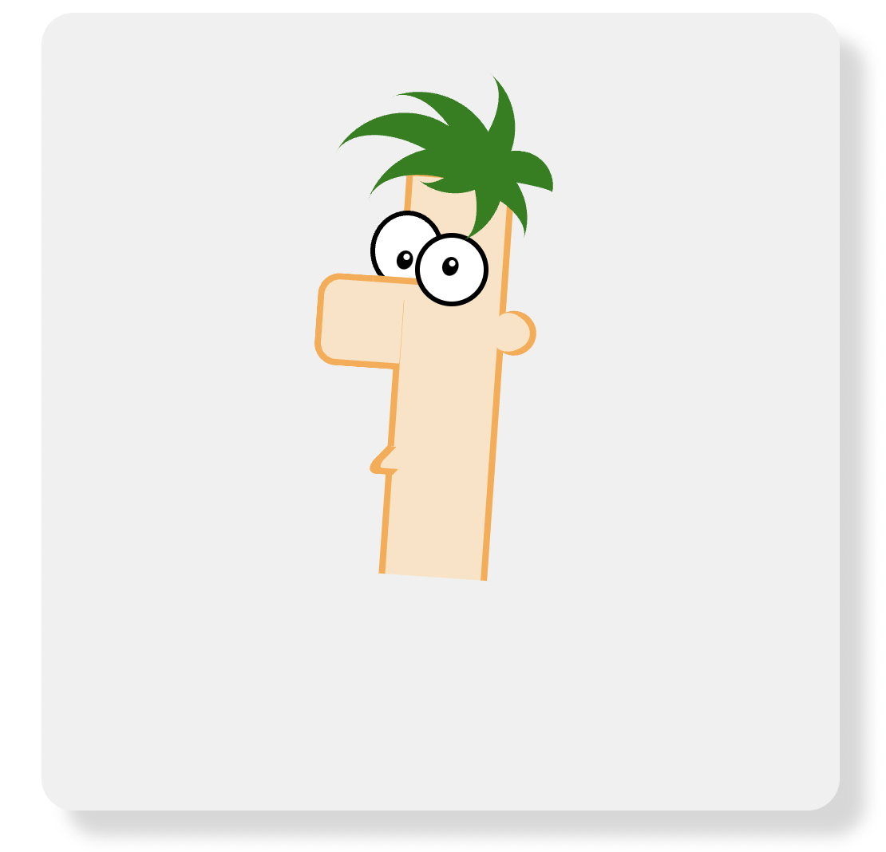
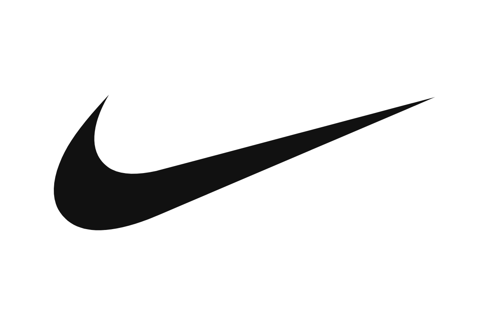

# CSS-Drawing

Drawings made with pure HTML and CSS, no images, SVG, or JavaScript.

Each drawing lives in its own folder with an `index.html`, a `style.css`, and a screenshot. To view one, open its `index.html` in a browser.

Click a thumbnail to see it full size, or a name to see its code.

<table>
  <tr>
    <td align="center">
       
      <a href="FERB-FACE">Ferb Face</a>
    </td>
    <td align="center">
       
      <a href="SHANAB">Shanab (mustache)</a>
    </td>
    <td align="center">
       
      <a href="Pokemon">Pokemon</a>
    </td>
  </tr>
  <tr>
    <td align="center">
       
      <a href="Homer">Homer</a>
    </td>
    <td align="center">
       
      <a href="cartoon-face">Cartoon-Face</a>
    </td>
    <td align="center">
       
      <a href="apple">Apple</a>
    </td>
  </tr>
  <tr>
    <td align="center">
       
      <a href="rolex">Rolex</a>
    </td>
    <td align="center">
       
      <a href="nike">Nike</a>
    </td>
  </tr>
</table>
